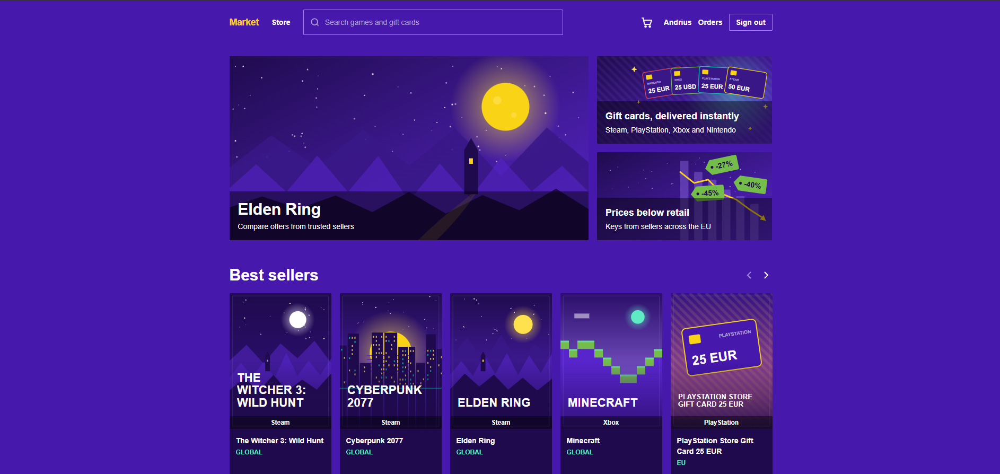
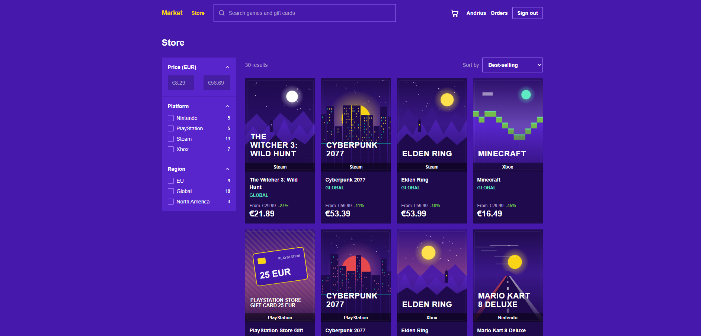
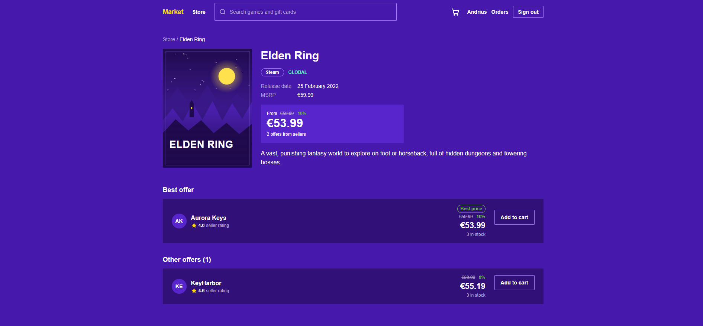

# Market: an Eneba-style game key marketplace

**Live: https://eneba-marketplace-rosy.vercel.app**

> **Be patient on first load!** The API runs on Render's free tier, which sleeps after 15 minutes without traffic. The first request after that can take about a minute while the server wakes up; after that the site is fast. If the homepage spins, give it a moment.

Demo account: `demo@example.com` / `password`. Test cards: `4242 4242 4242 4242` succeeds, `4000 0000 0000 0002` is declined.

Built for the Eneba intern assignment 2027.

| Homepage | Store | Product |
|---|---|---|
|  |  |  |

## What it does

A web marketplace for digital game keys that looks and feels like eneba.com. You browse and search the catalog, compare offers from several sellers, and buy a key, which you get straight away. Payment is simulated.

```
Homepage ─┐
          ├─► Product page ─► Cart ─► Checkout (sign-in) ─► Payment ─► Order + key
Search  ──┘
```

- **Homepage:** a hero banner, best sellers and deals. Each block comes from its own backend provider and table, and the order, titles and on/off state live in the database, so nothing about the homepage is hardcoded in the frontend.
- **Store and search** (built in depth):
  - Filters by platform, region and price, with facet counts.
  - Five sorts and 24 products per page.
  - The whole view lives in the URL, so reload, share and Back all restore it.
  - The header search box autocompletes on every page and handles partial names ("cyberp", "ring") and typos ("eldn ring", "witcer").
- **Product page:** offers from several sellers, sorted by price, with the best offer highlighted. Sold-out offers are shown but disabled.
- **Cart and checkout** (built in depth):
  - Anyone can fill the cart. Checkout requires signing in, and the cart survives the sign-in redirect.
  - The server re-prices everything, so a tampered price in the request is ignored.
  - Keys are claimed with row locks in one transaction, so a key is never sold twice. A concurrency test races 20 buyers for 5 keys.
  - Retries are idempotent, so a double click or a network retry never creates a second order.
- **Orders:** key codes are shown on screen with a copy button, and your order history keeps them.
- **Accounts:** register, sign in and sign out, with an httpOnly session cookie.

## Run locally

You need PHP 8.4 (with `pdo_pgsql`), Composer 2, Node 24 and a PostgreSQL 16 database. The `pg_trgm` extension must be available; the migrations create it. I used two [Neon](https://neon.tech) branches: `dev` for the app and `test` for the test suite. **The tests wipe their database**, so never point them at data you want to keep.

**Backend** (`backend/`, http://localhost:8000)

```sh
cd backend
composer install
cp .env.example .env
php artisan key:generate
# set DB_URL in .env to the database's direct connection string (with sslmode=require on Neon)
php artisan migrate --seed     # schema plus the demo catalog, users and orders
php artisan serve
```

**Frontend** (`frontend/`, http://localhost:5173)

```sh
cd frontend
npm ci
npm run dev
```

The Vite dev server proxies `/api` and `/sanctum` to `http://localhost:8000`, so the browser sees one origin, as in production. Set `API_PROXY_TARGET` in `frontend/.env.local` if the API runs elsewhere. Then open http://localhost:5173 and sign in with the demo account.

**Tests and checks**

```sh
# backend (needs its own database: the tests wipe it)
cp .env.testing.example .env.testing
php artisan key:generate --env=testing
# set DB_URL in .env.testing to the test database
php artisan test
vendor/bin/pint --test

# frontend
npm run test
npm run lint
npm run typecheck
npm run build
```

## Architecture overview

```
                 one origin: https://<app>.vercel.app
┌─────────┐      ┌──────────────────────────────┐      ┌───────────────────────┐      ┌──────────────┐
│ Browser │ ───► │ Vercel                       │ ───► │ Render (Docker)       │ ───► │ Neon         │
│  React  │      │  /*         → SPA index.html │      │  nginx + php-fpm      │      │  PostgreSQL  │
│   SPA   │      │  /api/*     → rewrite ───────┼────► │  Laravel API          │      │  pg_trgm     │
└─────────┘      │  /sanctum/* → rewrite ───────┼────► │                       │      └──────────────┘
                 └──────────────────────────────┘      └───────────────────────┘
```

| Layer | Choice |
|---|---|
| Frontend | React 19, TypeScript 7, Vite 8, React Router, TanStack Query, Tailwind CSS 4 (deployed on Vercel) |
| Backend | Laravel 13 on PHP 8.4, REST/JSON, Sanctum session auth (Docker on Render) |
| Database | PostgreSQL 16 on Neon. `pg_trgm` for typo-tolerant search, `FOR UPDATE SKIP LOCKED` for key claims |
| Tests | Pest against real Postgres (including a multi-process concurrency test), Vitest with Testing Library |

The browser only ever talks to the Vercel origin, and Vercel proxies the API to Render. That keeps the session cookie first-party and CORS closed. All money is integer euro cents.

**Docs:**
- [SPEC.md](docs/SPEC.md): what is in scope and what isn't, and why.
- [ARCHITECTURE.md](docs/ARCHITECTURE.md): data model, API, homepage block design, search approach and threshold tuning, the checkout transaction, auth trade-offs and deployment.
- [PLAN.md](docs/PLAN.md): the milestones, and how each one was verified.
- [DESIGN.md](docs/DESIGN.md): the design tokens taken from eneba.com.
- [ai-logs/](ai-logs/): the AI session logs. [AI_CHAT_HISTORY.md](AI_CHAT_HISTORY.md) combines them into one file.

## Scope decisions

The assignment says "a few features done extensively beat many fitting minimal requirements". So two features are built in depth and the rest to a correct, working minimum. The full reasoning is in [SPEC.md](docs/SPEC.md).

- **In depth:**
  - Store and search: one query engine behind both the Store filter and the header box.
  - Checkout and key integrity.
- **Minimal but complete:** homepage, product page, authentication, Eneba styling.
- **Interpretations of ambiguous requirements:**
  - "Search by name" and "search from anywhere" are one search engine with two entry points.
  - "Each block from its own service" means one provider class and one data source per block inside one Laravel app, not separately deployed services.
  - With no design file supplied, eneba.com itself is the reference. Its logo and images are not used.
  - Guests can have a cart, and sign-in is enforced at checkout.
  - The key is delivered on screen and stays in order history.
  - Payment is a simulated card form with Stripe-style test numbers.
- **Out of scope, on purpose:**
  - A seller dashboard: sellers, offers and keys are seeded.
  - An admin UI for the homepage: editing the database already changes it without a deploy.
  - A real payment provider.
  - Key reservation with a timeout.
  - Email delivery.
  - Password reset, email verification and social login.
  - Reviews and wishlists.
  - Multi-currency, VAT and i18n.
  - Refunds.
  - An external search engine.
  - Product variants.

## Known limitations

From [SPEC.md](docs/SPEC.md):

- **No real money moves.** Only the two test cards work, and there are no refunds or cancellations.
- **Keys are shown on screen only**, never emailed.
- **Accounts are basic:** no password reset, no email verification, no social login.
- **Everything is in EUR, in English.** A database CHECK allows only `EUR`.
- **Sellers, offers and keys are seed data.** No one can list a new offer.
- **Stock isn't held while you pay.** Keys are claimed at payment time, so an offer can sell out between the cart and payment. Checkout then answers 409, names the offer, and updates the cart.
- **Search has known gaps:**
  - It is trigram-based, so abbreviations ("gta") aren't understood.
  - A swapped letter inside a short word ("zleda") isn't found.
  - "halo" also matches Hades.
  - The threshold measurements are in [ARCHITECTURE.md › Search approach](docs/ARCHITECTURE.md#search-approach).

Beyond the spec, in the current build:

- **The first request after 15 idle minutes is slow** (Render free tier; see the note at the top).
- **CI and the Playwright end-to-end test aren't set up yet** (PLAN.md M9). Tests run locally against a real Postgres.
- **The page renders in Arial**, not Eneba's Metropolis, until the font is self-hosted.

## How I used AI

### Workflow

1. **Plan before code.** Before any code existed, I worked out the scope and the architecture with the AI and agreed them in [SPEC.md](docs/SPEC.md), [ARCHITECTURE.md](docs/ARCHITECTURE.md) and [PLAN.md](docs/PLAN.md). The rule for that session: when a question has no obvious answer, give 2–3 options with trade-offs and a recommendation, and flag anything ambiguous in the assignment.
2. **Set guardrails.**
   - [DESIGN.md](docs/DESIGN.md) records design tokens measured from eneba.com screenshots, each labeled as measured or estimated.
   - [CLAUDE.md](CLAUDE.md) holds the project rules: plan before editing, ask before adding a dependency, run the tests before calling something done, ask instead of guessing, and never handle secret values.
   - A read-only reviewer subagent checks code against the spec.
3. **One session per milestone.** Each prompt named the milestone, its constraints and a "done when", and asked for a plan or an API contract first. I reviewed the plan and answered the AI's questions before it wrote code. Then the tests, lint and type-check had to pass, and I checked the result myself (locally, and for auth and checkout on the live URL). After that the milestone was ticked in PLAN.md and merged through a pull request.
4. **Decisions from evidence.**
   - The search threshold was chosen after measuring real similarity scores against the seeded titles.
   - The checkout tests were mutation-checked: removing the lock had to make the race test fail. One of those runs corrected a wrong claim in ARCHITECTURE.md.
5. **Review at the end.**
   - The reviewer subagent went through the whole codebase. It looked at security, checkout correctness, missing tests, and code I'd struggle to explain. I then fixed its top findings.
   - I compared screenshots of the app with eneba.com and fixed the biggest differences.

### Tools

- **Claude Code** (VS Code extension) with **Claude Opus 5.5**. It handled every coding session, from reading code and running tests to editing, committing and opening pull requests.
- **Project setup for the AI:**
  - `CLAUDE.md` for project rules.
  - A custom read-only reviewer subagent ([.claude/agents/reviewer.md](.claude/agents/reviewer.md)).
  - Explore subagents to read the frontend and backend in parallel.
  - Plan mode for milestone plans.
  - `/export` to save each session to [ai-logs/](ai-logs/).
- **A separate planning chat** before the coding sessions (link in [ai-logs/README.md](ai-logs/README.md)).
- **Not AI:** the Neon, Render and Vercel dashboards, GitHub, and the browser for manual checks.

### How everything was split

**What I did:**
- Decided the scope and every architecture choice, picking among the options the AI laid out. For example: session cookies instead of API tokens, `word_similarity` for search, and building two features in depth.
- Answered its questions whenever the docs didn't settle something.
- Ran every dashboard step myself and kept all secrets out of the chat. The AI only ever saw variable names.
- Approved the plans and checked the results in the browser and on the live site.

**What the AI did:**
- Drafted the docs from our discussion.
- Wrote the code and the tests, and ran the test suites.
- Measured the search scores.
- Reviewed the code through the subagent.
- Wrote the commit messages and pull request descriptions.

**Shared:** verification. The AI ran the automated checks, and I confirmed the behaviour by hand, including in production.
